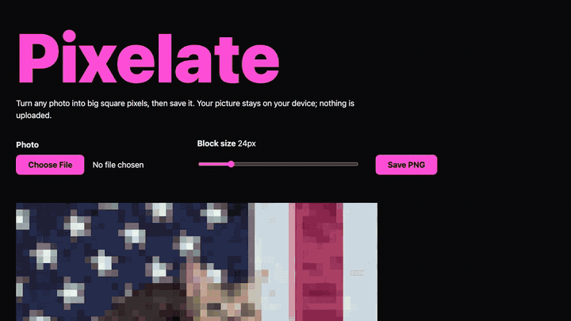

# Pixelate



Pixelate turns any photo into big square blocks, and the photo never leaves your
phone or computer. Drag the slider and the picture gives up its detail a little
at a time, until it's a grid of colors. It's the oldest of my pixel projects,
from 2015.

[Try it at pixelate.joekarlsson.com](https://pixelate.joekarlsson.com) ·
[Read the full statement](https://www.joekarlsson.com/work/pixelate/)

## Quick start

```sh
git clone https://github.com/JoeKarlsson/Pixelate.git
cd Pixelate
npm install
npm run serve      # http://localhost:47391
```

## Development

```sh
npm test           # unit tests (node --test)
npm run test:e2e   # Playwright on desktop Chrome, iPhone WebKit and Pixel Chrome, with axe
npm run images     # re-render the share card and PNG icons from site/favicon.svg
```

`site/js/pixelate-math.js` holds the size math and `site/js/pixelate.js` wires
up the page. I wrote up the technique in
[How to pixelate images with HTML5 and JavaScript](https://www.joekarlsson.com/blog/how-to-pixelate-images-with-html5-and-javascript/).

Pushing to `master` runs the tests and deploys `site/` to GitHub Pages. Bump
`Expires` in `site/.well-known/security.txt` before it lapses; a unit test
fails a month ahead.

## License

Made by [Joe Karlsson](https://www.joekarlsson.com/). Code MIT.
